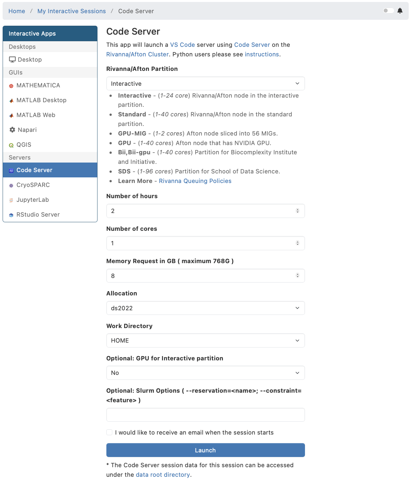

# HPC

This session introduces the **UVA HPC cluster** (Afton/Rivanna): you log in, find your storage and software, and submit your first batch jobs with **Slurm**.

## In-class exercises

| Part | Activity                                    |
| ---- | ------------------------------------------- |
| 1    | Log in, storage, and software modules       |
| 2    | Clone the course repository                 |
| 3    | Open OnDemand interactive apps              |
| 4    | Job examples: serial, job array, GPU        |

### Part 1: Log in, storage, and software modules

**Log in.** Follow [HPC Access](../../setup/hpc.md).

- **ssh** from your terminal: `ssh mst3k@login.hpc.virginia.edu` (replace `mst3k` with your computing ID). **The password is your UVA Netbadge password.** Off Grounds, connect to the UVA VPN first.
- **Open OnDemand** in your browser: [ood.hpc.virginia.edu](https://ood.hpc.virginia.edu), with a shell, a file browser, and VSCode or JupyterLab sessions. It works without the VPN.

Either way, you land on a **login node**, shared with many other users. Edit files, manage software, and submit jobs here; run computations as jobs on the compute nodes.

**Storage.** Every account has two directories:

| Directory | Size | Use it for |
| --- | --- | --- |
| `/home/mst3k` (`~`) | 200 GB, no backup, but snapshots: recover recently deleted files from `/home/.snapshots` | code, scripts, configuration such as `~/.bashrc` |
| `/scratch/mst3k` | 10 TB, no backup, no snapshots; files unused for 90 days are deleted | data and results of your jobs |

`hdquota` shows how much of each you use:

```bash
hdquota
```

```text
Storage Type       Location                             Size       Used      Avail  Use%
------------       --------                             ----       ----      -----  ----
Home Directory     /home/mst3k                      200.0 GB   167.7 GB    32.3 GB   84%
Scratch            /scratch/mst3k                    10.0 TB    14.0 GB    10.0 TB    0%
```

**Software modules.** Most software on the cluster is installed as modules that you load when you need them:

| Command | What it does |
| --- | --- |
| `module avail` | lists the modules you can load |
| `module spider <name>` | searches for a module, shows its versions and how to load it |
| `module load <name>` | loads a module into your current shell |
| `module list` | shows the modules loaded in your shell |
| `module purge` | unloads all modules |

For example, search for the AWS CLI:

```bash
module spider awscli
```

```text
  awscli: awscli/2.35.13
    Description:
      This package provides a unified command line interface to Amazon Web Services.

    This module can be loaded directly: module load awscli/2.35.13
```

See what loading a module does. Run each command on its own, and look at its output before you run the next one.

1. Ask for the version of `uv`:
   ```bash
     uv --version
   ```

     `uv` is installed on the cluster, but your shell doesn't know where to find it.
2. Load the `uv` module:
   ```bash
     module load uv
   ```
3. Ask for the version again:
   ```bash
     uv --version
   ```

     Now the shell finds `uv` and prints its version.

A loaded module lasts only for your current shell. When you log in again, or in a job script, load it again.

### Part 2: Clone the course repository

Clone it into your home directory on the cluster; Part 4 uses its job scripts:

```bash
cd && git clone https://github.com/ksiller/DS2022.git
```

If you cloned it before, update it instead: `cd ~/DS2022 && git pull`.

### Part 3: Open OnDemand interactive apps

**Interactive Apps** in [Open OnDemand](https://ood.hpc.virginia.edu) start a program such as JupyterLab, VSCode (Code Server), or a Linux desktop on a **compute node**, and show it in your browser. You fill in a form with what the session needs: the allocation `ds2022`, the partition, CPU cores, memory, a GPU if needed, and how many hours. Open OnDemand turns the form into a Slurm job; when the job starts, you connect to it.

1. In your web browser, go to https://ood.hpc.virginia.edu. Login via Netbadge with your UVA computing ID and password.
2. In the Open OnDemand menu, click **Interactive Apps** → **Code Server** (that's VSCode).
3. Fill in the form with these values, then click **Launch**. Starting may take a few minutes.
   | Field | Value |
     | --- | --- |
     | Rivanna/Afton Partition | Interactive |
     | Number of hours | 2 |
     | Number of cores | 1 |
     | Memory Request in GB | 8 |
     | Allocation | `ds2022` |
     | Work Directory | HOME |
     | Optional: GPU for Interactive partition | No |
     | Optional: Slurm Options | (empty) |

     

> [!NOTE]
> Many students are trying to start a session at the same time today. If yours does not start, continue with [Part 4: Job examples](#part-4-job-examples) from the command line.

4. When the session is ready, click **Connect to VSCode**.
5. Open a terminal in VSCode (**Terminal** → **New Terminal**) and run `hostname`: the name is a compute node, not the login node.
6. When you are done, click **Delete** on the session card in **My Interactive Sessions**. The session holds its cores until its hours run out, even if you close the browser tab.

[HPC Access](../../setup/hpc.md#login-via-web-browser) shows the VSCode form, and how to start JupyterLab or a Linux desktop the same way.

### Part 4: Job examples

Change into this directory of the course repository you cloned in Part 2:

```bash
cd ~/DS2022/class/08-hpc
```

Submit each job script from this directory with `sbatch`. Slurm prints the job ID; `squeue --me` shows your waiting and running jobs, and each job writes its output into a file in this directory.

| Job script | Runs | Output |
| --- | --- | --- |
| [01_job.slurm](01_job.slurm) | a **serial** job on the `interactive` partition: one task, one CPU core, runs [my_script.py](my_script.py) | `hello-<job ID>.out` |
| [02_job_array.slurm](02_job_array.slurm) | a **job array** of 5 tasks on the `interactive` partition; each runs [my_array.py](my_array.py) with its task ID from `$SLURM_ARRAY_TASK_ID` | `hello-array-<job ID>_<task ID>.out` |
| [03_gpu.slurm](03_gpu.slurm) | a **GPU** job: one slice of a GPU on the `gpu-mig` partition, lists it with `nvidia-smi -L` | `hello-gpu-<job ID>.out` |

Run each command on its own, and look at its output before you run the next one. Start with the serial job:

1. Submit it:
   ```bash
     sbatch 01_job.slurm
   ```

     The number is the **job ID**. Yours is different; use it in place of `22492513` in the next steps.
2. Check the queue:
   ```bash
     squeue --me
   ```

     `ST` is the job's state: `PD` pending, `R` running. Run `squeue --me` again every few seconds. When the job is no longer listed, it has finished.
3. Check how the job ended:
   ```bash
     sacct -X --format=JobID,JobName,Partition,NodeList,AllocCPUS,Start,Elapsed,End,State%20,ExitCode
   ```

     `squeue` shows only jobs that wait or run; `sacct` also shows finished ones: all your jobs since midnight. Find this one by its job ID. `sacct` shows on which partition and compute node (`NodeList`) the job ran, how many CPU cores it got (`AllocCPUS`), when it started and ended, and how long it ran (`Elapsed`). A `+` at the end of a value means that it was cut off to fit the column: `interacti+` is `interactive`. `-X` shows one line per job, without the job's steps, and `State%20` widens the `State` column to 20 characters. `COMPLETED` with exit code `0:0` means the job ran without errors; `FAILED` or `TIMEOUT` means it did not, and `CANCELLED` means that you, or an administrator, cancelled it with `scancel` (below).
4. Read its log file. **Replace** `22492513` with your job ID:
   ```bash
     cat hello-22492513.out
   ```

     The `--output=hello-%j.out` directive in `01_job.slurm` named the file: Slurm replaces `%j` with the job ID. Everything the job prints goes into this file, including error messages.

Then do the same for `02_job_array.slurm` and `03_gpu.slurm`. The job array writes one output file per task: list them with `ls hello-array-*`.

The `#SBATCH` directives at the top of each script define the job's resource requests (partition, CPU cores, memory, GPU, time limit) and its parameters (allocation `ds2022`, job name, array, output file). Compare the three scripts: what changes between them?

**Cancel a job.** `scancel` removes a job from the queue, or stops it if it already runs. The serial job finishes within seconds, too fast to cancel, so submit it with a start time 10 minutes from now; it waits in the queue until then. Run each command on its own:

1. Submit the job with a delayed start:
   ```bash
     sbatch --begin=now+10minutes 01_job.slurm
   ```
2. Check the queue:
   ```bash
     squeue --me
   ```

     The reason `(BeginTime)` means that the job waits for its start time.
3. Cancel it. **Replace** `22492577` with your job ID:
   ```bash
     scancel 22492577
   ```

     `scancel` prints nothing when it succeeds.
4. Check the queue again:
   ```bash
     squeue --me
   ```

     The job is gone.
5. Check how it ended:
   ```bash
     sacct -X --format=JobID,JobName,Partition,NodeList,AllocCPUS,Start,Elapsed,End,State%20,ExitCode
   ```

     The state is `CANCELLED`, followed by the numeric user ID of whoever cancelled the job: you; without `State%20`, `sacct` cuts it off to `CANCELLED+`. The job never started: it got no compute node (`NodeList` is `None assigned`) and no CPU cores (`AllocCPUS` is `0`), ran for `00:00:00`, and wrote no log file.

`scancel --me` cancels all your jobs at once; use it with care.

## Advanced topics

Optional. Submit these jobs from this directory (`~/DS2022/class/08-hpc`), too.

| Job script | Runs | Output |
| --- | --- | --- |
| [04_pi_serial.slurm](04_pi_serial.slurm) | estimates π with [serial_pi.py](serial_pi.py) on one CPU core | `pi-serial-<job ID>.out`, `pi-serial.csv` |
| [05_pi_mp.slurm](05_pi_mp.slurm) | estimates π with [mp_pi.py](mp_pi.py) on 8 CPU cores of one node | `pi-mp-<job ID>.out`, `pi-mp.csv` |
| [06_pytorch.slurm](06_pytorch.slurm) | trains a small neural network with [pytorch_mnist.py](pytorch_mnist.py) on one GPU slice | `pytorch-mnist-<job ID>.out` |

### Single-node multiprocessing

This example goes from a **serial** Python job, one process on one CPU core, to a **multiprocessing** job, several processes on several CPU cores of the *same node*. It uses Python's `multiprocessing` package and changes two `#SBATCH` directives in the job script.

Both scripts estimate π with the **Monte Carlo method**. The key function in [serial_pi.py](serial_pi.py):

```python
def calculate_pi(num_points):
    """
    Calculate pi using the Monte Carlo method. We use an inefficient for loop on purpose to demonstrate the serial nature of the computation.
    """
    master = random.Random()
    seed = master.randint(0, 2**32 - 1)
    random.seed(seed)
    logging.info(f"Calculating pi using {num_points} points")
    num_inside = 0
    for _ in range(num_points):
        x = random.random()
        y = random.random()
        if x**2 + y**2 <= 1:
            num_inside += 1
    return 4 * num_inside / num_points
```

- Picture a unit square, [0,1] × [0,1], with a quarter of a circle of radius 1 inside it.
- The loop throws `num_points` random "darts" into the square: `x` and `y` are random numbers between 0 and 1.
- It counts how many land **inside the quarter circle** (`x**2 + y**2 <= 1`) in `num_inside`.
- The fraction `num_inside / num_points` approximates the ratio of the two areas: (area of the quarter circle) / (area of the square) = π/4.
- Multiplying by 4 gives an estimate of π.

The more darts, the closer the estimate gets to π, but the longer the calculation takes. [04_pi_serial.slurm](04_pi_serial.slurm) throws 100 million (`NUM_POINTS=100000000`) and writes the result to `pi-serial.csv`. Submit it:

```bash
sbatch 04_pi_serial.slurm
```

**Multiprocessing.** With several CPU cores, the same calculation can be split into chunks, one per core, and each chunk runs in its own process. [05_pi_mp.slurm](05_pi_mp.slurm) is almost the same as the serial job script; two directives change:

| Directive | Serial | Multiprocessing |
| --- | --- | --- |
| CPU cores | `--cpus-per-task=1` | `--cpus-per-task=8` |
| Memory | `--mem=8G`, for the whole job | `--mem-per-cpu=8G`, for each CPU core: 64 GB in total |

The job script passes `$SLURM_CPUS_PER_TASK`, which Slurm sets to the number of CPU cores the job got, to [mp_pi.py](mp_pi.py) as the third argument. The Python script starts exactly that many worker processes, so the number of processes always matches the cores:

```bash
uv run --with pandas python mp_pi.py "$NUM_POINTS" "$OUTPUT_FILE" "$SLURM_CPUS_PER_TASK"
```

`mp_pi.py` changes `calculate_pi` and adds a function `count_inside`:

- `calculate_pi(num_points, num_processes)` splits the points into `num_processes` chunks.
- A `multiprocessing.Pool` runs `count_inside` on each chunk in parallel, then adds up the counts and estimates π in the same way as the serial version.

```python
def calculate_pi(num_points, num_processes):
    """
    Distribute num_points across num_processes workers; sum inside counts and compute pi.
    """
    logging.info(f"Calculating pi using {num_points} points and {num_processes} processes")
    master = random.Random()
    base_seed = master.randint(0, 2**32 - 1)
    # distribute the numpoints across the workers
    chunk_size = num_points // num_processes
    remainder = num_points % num_processes
    chunks = []
    for i in range(num_processes):
        n = chunk_size + (1 if i < remainder else 0)
        if n > 0:
            chunks.append((n, base_seed, i))
    logging.info(f"Chunks: {chunks}")

    # create a pool of workers and map the count_inside function to the chunks
    # counts is a list of results returned by each worker
    with Pool(processes=num_processes) as pool:
        counts = pool.map(count_inside, chunks)
    
    # aggregate the results
    total_inside = sum(counts)
    return 4.0 * total_inside / num_points
```

```python
def count_inside(args):
    """
    Worker: generate n_points random (x,y) and return how many fall inside unit circle.
    args = (n_points, base_seed, worker_id) so each worker has distinct RNG state.
    """
    n_points, base_seed, worker_id = args
    random.seed(base_seed + worker_id)
    num_inside = 0
    for _ in range(n_points):
        x = random.random()
        y = random.random()
        if x * x + y * y <= 1.0:
            num_inside += 1
    logging.info(f"Worker {worker_id}: {num_inside} points of {n_points} points inside are within the unit circle")
    return num_inside
```

Each worker process runs `count_inside`: it throws its share of the darts, the same way as the serial version. It gets the number of darts, a seed for the random number generator, and its worker ID; the seed plus the worker ID gives each worker its own sequence of random numbers.

Submit the multiprocessing job:

```bash
sbatch 05_pi_mp.slurm
```

When both jobs are no longer listed by `squeue --me`, compare their CPU cores and run times (`Elapsed`):

```bash
sacct -X --format=JobID,JobName,Partition,NodeList,AllocCPUS,Start,Elapsed,End,State%20,ExitCode
```

How much faster is the job with 8 cores? Is it 8 times faster?

### GPU jobs with PyTorch

[PyTorch](https://pytorch.org/) is a widely used framework for deep learning. Training a neural network is much faster on a **GPU** than on CPU cores, so the cluster has GPU nodes that a job can request. [pytorch_mnist.py](pytorch_mnist.py) is the official [PyTorch MNIST example](https://github.com/pytorch/examples/tree/main/mnist): it trains a small convolutional neural network on the MNIST dataset of handwritten digits, for 14 epochs. It prints the training loss as it goes and, after each epoch, the loss and accuracy on the test set. It downloads the dataset the first time it runs, into `~/DS2022/class/data`.

[06_pytorch.slurm](06_pytorch.slurm) requests one slice of a GPU, like [03_gpu.slurm](03_gpu.slurm), and runs the script inside an **Apptainer container** that has PyTorch installed (more on containers later in the course):

- `--partition=gpu-mig` and `--gres=gpu:1`: one GPU slice; a GPU job needs both.
- `--cpus-per-task=4`, `--mem=32G`, `--time=00:10:00`: CPU cores and memory for loading the data, and the time limit. A job on `gpu-mig` gets at most 4 CPU cores.
- `module load apptainer` and `module load pytorch`: load Apptainer, and set `$CONTAINERDIR` to the directory that holds the PyTorch container image.
- `apptainer run --nv $CONTAINERDIR/pytorch-2.9.0.sif pytorch_mnist.py`: run the script inside the container; `--nv` gives the container access to the GPU.

Submit it:

```bash
sbatch 06_pytorch.slurm
```

When the job has finished, look at the end of its log. **Replace** `22492600` with your job ID:

```bash
tail pytorch-mnist-22492600.out
```

The last lines show the result on the test set after the last epoch, for example:

```text
Test set: Average loss: 0.0283, Accuracy: 9912/10000 (99%)
```

Your numbers may differ slightly. The training progress (epoch, batch, loss) is above this line.

### Batch directives, partitions, and limits

The `#SBATCH` directives at the top of a job script request the resources for the job, such as CPU cores, memory, GPUs, and a time limit, and set its parameters, such as the allocation and the log file. The most common ones in the examples above are listed below; the [sbatch documentation](https://slurm.schedmd.com/sbatch.html) lists them all.

#### Allocation account

```bash
#SBATCH --account=ds2022
```

The allocation that the job's compute time is charged to. Use the course allocation `ds2022`. `allocations` lists the allocations you have access to:

```bash
allocations
```

```text
Account                      Balance        Reserved       Available
-----------------          ---------       ---------       ---------
ds2022                       1000000               0          999559
```

`Available` is the number of service units (SUs) left; SUs are credits for compute time. When it reaches zero, nobody can submit new jobs with the allocation. If that happens, tell your instructor.

#### Job name

```bash
#SBATCH --job-name=hello
```

A name for the job, shown by `squeue` and `sacct`.

#### Output and error files

```bash
#SBATCH --output=hello-%j.out
#SBATCH --error=hello-%j.err
```

The files for the job's standard output (stdout) and standard error (stderr). `%j` is replaced by the job ID, so every job gets its own files; in a job array, `%A` is the job ID and `%a` the task ID. Without `--error`, stderr goes into the `--output` file too, as in the job scripts of this class.

#### Partition

```bash
#SBATCH --partition=standard
```

The partition (queue) the job runs on. A partition is a group of compute nodes, often with the same hardware or for the same kind of job. In this class:

- `interactive`: short jobs and Open OnDemand apps such as VSCode and JupyterLab
- `standard`: longer jobs on CPU cores
- `gpu-mig`: jobs on one slice of a GPU
- `gpu`: jobs on whole GPUs

A job on `gpu` or `gpu-mig` also needs a `--gres` directive for the GPU.

#### GPU resource (gres)

```bash
#SBATCH --gres=gpu:1
```

Requests one GPU, or one GPU slice on `gpu-mig`. On `gpu`, `gpu:2` or more requests several GPUs for one job.

#### Nodes

```bash
#SBATCH --nodes=1
```

The number of compute nodes. All examples here use one node; jobs on several nodes (`--nodes=2` or more) are for programs that distribute their work across machines, for example with MPI.

#### Tasks per node

```bash
#SBATCH --ntasks-per-node=1
```

The number of tasks (separate programs) per node. A serial or multiprocessing Python script is one task. More than one is for programs that run as several copies, for example with MPI.

#### CPUs per task

```bash
#SBATCH --cpus-per-task=4
```

The number of CPU cores per task, for programs that use several threads or processes, such as [mp_pi.py](mp_pi.py), or that load data in parallel.

#### Memory

```bash
#SBATCH --mem=32G
```

The memory (RAM) for the job on each node: 32 GB here. Alternatively, `--mem-per-cpu=8G` requests memory for each CPU core. Use it for multithreaded or multiprocessing programs: when you request more cores, the memory grows with them, and no process runs short. `--mem` and `--mem-per-cpu` exclude each other; use one or the other.

#### Time limit

```bash
#SBATCH --time=00-00:10:00
```

The maximum run time (days-hours:minutes:seconds), 10 minutes here. When a job reaches it, Slurm stops the job, and `sacct` shows `TIMEOUT`. Request only what you need: shorter jobs often start sooner.

#### Partitions and limits

`qlist` lists the partitions and how busy they are. You may not have access to all of them.

```bash
qlist
```

```text
PARTITION                     TOTAL_CORES FREE_CORES  RUNNING_JOBS   PENDING_JOBS   TIMELIMIT
----------------------------------------------------------------------------------------------------
standard                      17936       3400        1612           7274           7-00:00:00
dedicated                     400         136         3              4              infinite
interactive                   2136        2057        20             976            12:00:00
parallel                      17184       2982        112            538            3-00:00:00
gpu                           5600        2080        288            5526           3-00:00:00
gpu-mig                       128         62          17             1              3-00:00:00
```

`qlimits` shows the most CPU cores, GPUs, memory, and nodes you can request on each partition:

```bash
qlimits
```

```text
Queue          Maximum      Maximum          Minimum      Maximum       Maximum       Default       Maximum      Minimum
(partition)    Submit       Cores(GPU)/User  Cores/Job    Mem/Node(MB)  Mem/Core(MB)  Mem/Core(MB)  Nodes/Job    Nodes/Job
========================================================================================================================
standard       5000         cpu=1500                      384000+                     4000          1
dedicated      10000                                      768000+                     4000          UNLIMITED
interactive    5000         cpu=24                        128000+                     4000          2
parallel       2000         cpu=6000                      768000                      4000          64           2
gpu            10000        gres/gpu=32                   257000+                     4000          16
gpu-mig        2000         gres/gpu=16                   2200000       17000         4000          1
```

Both commands show the state at the time you run them, so your numbers will differ.

## Resources

- [HPC Access](../../setup/hpc.md): logging in with ssh and Open OnDemand
- [UVA Research Computing](https://www.rc.virginia.edu/) and [Introduction to HPC](https://learning.rc.virginia.edu/notes/hpc-intro/)
- [Slurm from the command line](https://learning.rc.virginia.edu/notes/slurm-from-cli/)
- Slurm documentation: [sbatch](https://slurm.schedmd.com/sbatch.html), [job arrays](https://slurm.schedmd.com/job_array.html), [squeue](https://slurm.schedmd.com/squeue.html)
