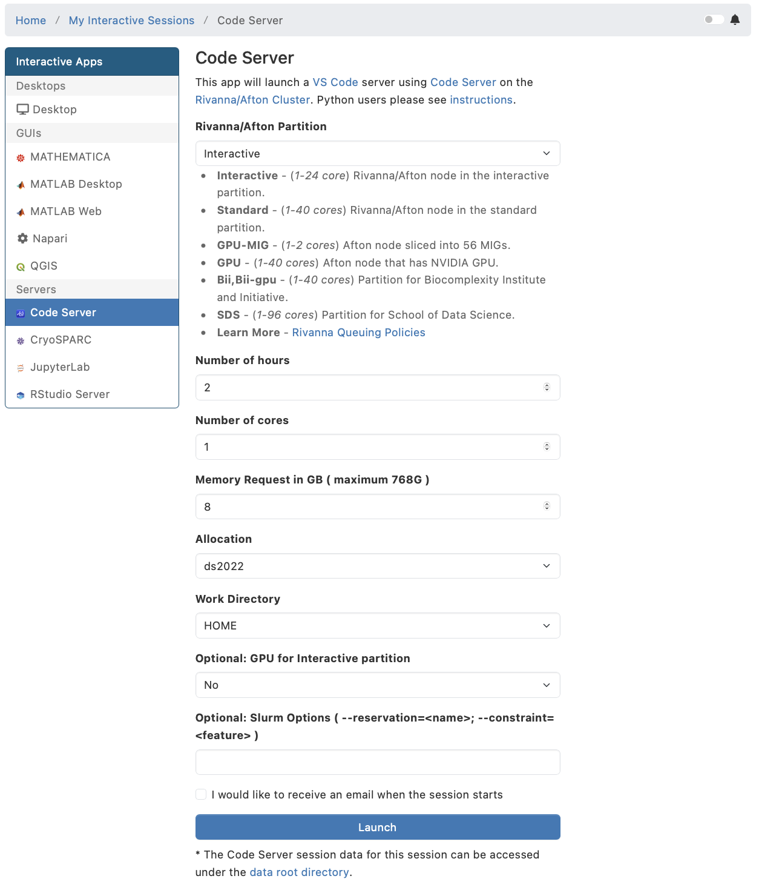
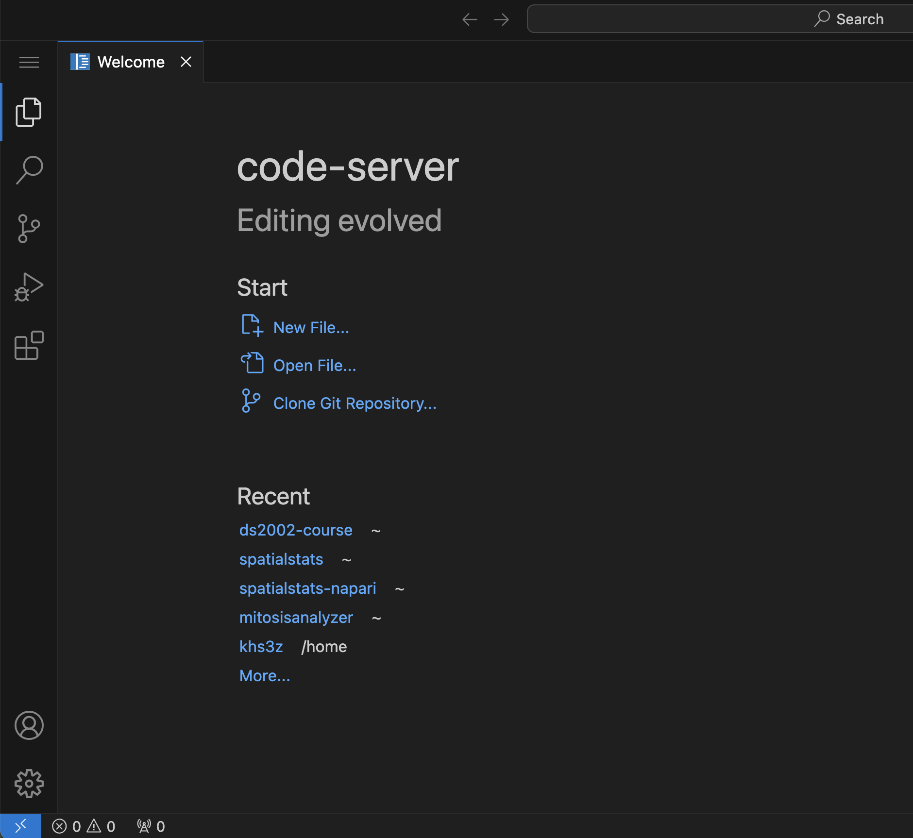
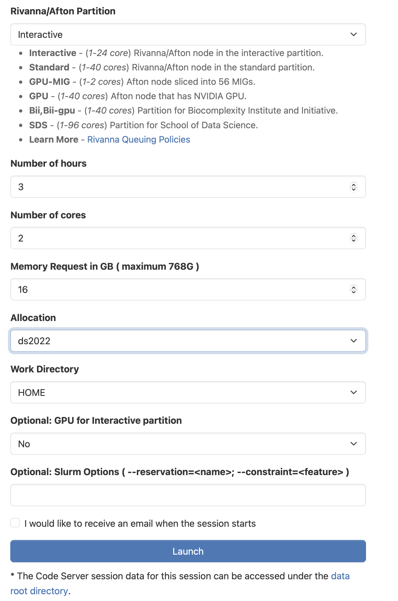
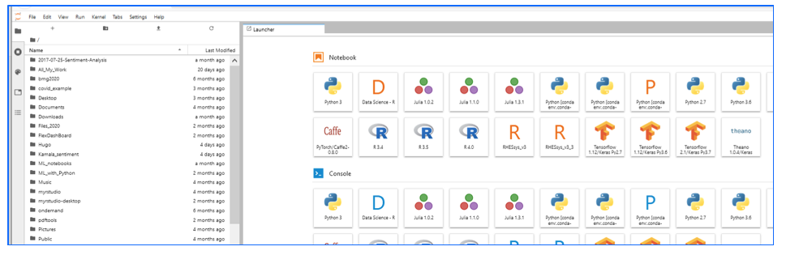
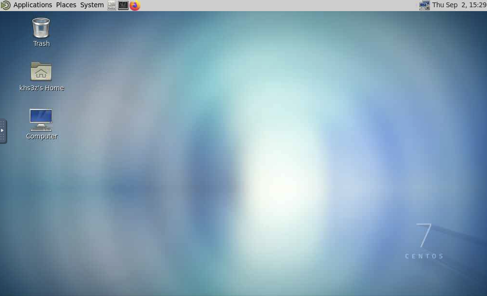

# HPC Access

The UVA High Performance Computing (HPC) systems (Rivanna and Afton) are accessible through a web portal, secure shell terminals, or a remote desktop environment. See the [official documentation](https://rc.virginia.edu/services/compute-and-storage/aftonrivanna).

> [!IMPORTANT]
> **Service Unit Allocation:** This course uses the `ds2022` allocation. Select `ds2022` in the **Allocation** field whenever you request an interactive Open OnDemand session (Code Server (VSCode), JupyterLab, Desktop), and use it for every compute job you submit (`#SBATCH --account=ds2022` in your Slurm scripts, Lab 08).
>
> - If you have taken other courses that use HPC, the Allocation drop-down may list more than one allocation. Always choose `ds2022` for this course.
> - If `ds2022` is not in the drop-down, you have not been added to the allocation yet. Contact the instructor; do not use another allocation instead.

**Off Grounds:** Connect to the [UVA VPN](https://in.virginia.edu/vpn) first, for both the web portal and `ssh`.

## Login via SSH

From a terminal on your computer (Mac Terminal, WSL, or Linux), log in to an HPC login node with your computing ID (same pattern as [Lab 01](https://github.com/ksiller/lab-01-cli), Part 2):

```bash
ssh mst3k@login.hpc.virginia.edu
```

Replace `mst3k` with your UVA computing ID. Enter your NetBadge password when prompted (nothing appears as you type; that is normal). The first time you connect, confirm the host key fingerprint with `yes`.

**Off Grounds:** Connect to the [UVA VPN](https://in.virginia.edu/vpn) first, or the connection will time out.

To log in without typing your password every time, set up an SSH key (Lab 01, Optional: SSH keys).

Type `exit` to leave the login node and return to your local shell.

Login nodes are shared. Use them for editing files, `git`, `module load`, `uv sync`, and submitting jobs (`sbatch`). Do **not** run long computations there; those belong in interactive Open OnDemand sessions or Slurm batch jobs with `#SBATCH --account=ds2022`.

## Login via Web Browser

Open OnDemand is a graphical user interface that allows access to HPC via a web browser. The Open OnDemand access point is [ood.hpc.virginia.edu](https://ood.hpc.virginia.edu). Within the Open OnDemand environment, users have access to a file explorer; interactive applications such as VSCode, JupyterLab and RStudio Server; a command-line interface; and a job composer and job monitor to submit jobs to the Rivanna and Afton clusters.

### Step 1: Start Open OnDemand

To start the Open OnDemand web client, go to [https://ood.hpc.virginia.edu](https://ood.hpc.virginia.edu). Your username is your UVA computing ID, and your password is your NetBadge password.


Proceed with one of these options:

[Step 2a: VSCode](#step-2a-vscode)

[Step 2b: JupyterLab](#step-2b-jupyterlab)

[Step 2c: Linux Desktop](#step-2c-linux-desktop)

### Step 2a: VSCode

1. In the menu bar of the Open OnDemand dashboard, click on `Interactive Apps`.
2. In the drop-down box, click on `Code Server` (that's VSCode).

**Select** `ds2022` **in the Allocation field.**

The form should look like this:



After you click `Launch` it may take a few minutes to start up. This is expected as we are sharing the cluster with hundreds of other users.

When ready, click the `Connect to VSCode` button.



### Step 2b: JupyterLab

1. In the menu bar of the Open OnDemand dashboard, click on `Interactive Apps`.
2. In the drop-down box, click on `JupyterLab`.

**Select** `ds2022` **in the Allocation field.**

The form should look like this:



After you click `Launch` it may take a few minutes to start up. This is expected as we are sharing the cluster with hundreds of other users.

When ready, click the `Connect to Jupyter` button.



- When JupyterLab starts, you will see a list of files (if any) in your home directory and a set of tiles for notebooks and consoles (for example, Python or R).
- You may see a slightly different set of tiles in your account; the screenshot shows some customized tiles from the instructor's account that you may not have (or need for this course).

### Step 2c: Linux Desktop

1. In the menu bar of the Open OnDemand dashboard, click on `Interactive Apps`.
2. In the drop-down box, click on `Desktop`.

**Select** `ds2022` **in the Allocation field.**

The form should look like this:


After you click `Launch` it may take a few minutes to start up. This is expected as we are sharing the cluster with hundreds of other users.

When ready, click the `Launch Desktop` button (wording may vary slightly).




## MongoDB Atlas from HPC

To reach your MongoDB Atlas cluster from HPC, the Atlas IP access list must allow UVA addresses. See [Update the IP access list](mongodb.md#2-update-the-ip-access-list).